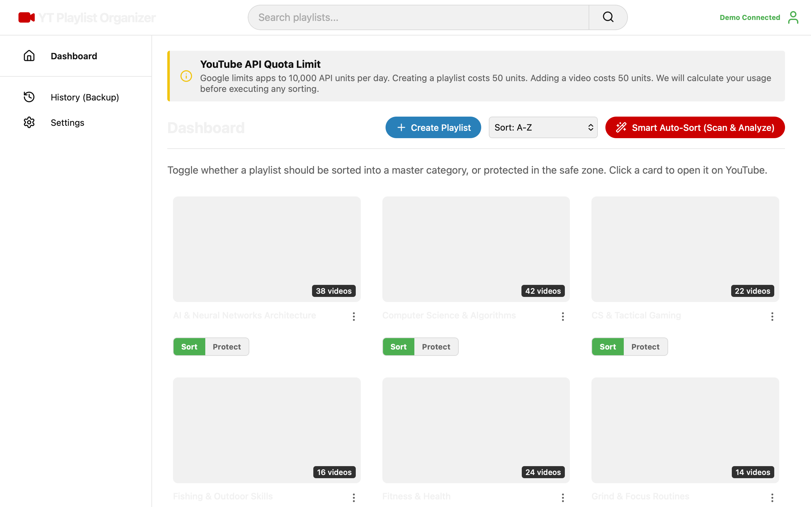
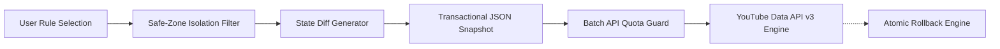

# YouTube Playlist Organizer: Bulk Sort, Clean & Categorize Playlists


A production-grade web and desktop application engineered to solve YouTube playlist sprawl. Automatically scans, categorizes, and consolidates fragmented playlists into structured master collections using Google Identity Services (GIS) OAuth 2.0 PKCE and the YouTube Data API v3—backed by non-destructive transactional rollbacks and strict quota budgeting.

---

## Screenshots

| Bulk Playlists & Safe Zones | Smart Auto-Sort (Merge Preview) |
|:---:|:---:|
|  |  |

| Backup History (Transactional Revert Logs) | Appearance & Quota Settings |
|:---:|:---:|
|  |  |

> [!TIP]
> **Interactive Demo Mode**: Click **"Explore Demo"** in the top navigation or append `?demo=true` to the URL to instantly test the app with 18+ realistic playlists, nested video items, safe zones, and automated category plans without needing Google OAuth API credentials.

---

## Systems Architecture & Data Safety



1. **Transactional Rollback Engine**:
   - Destructive operations (merges, deletes, bulk reorganization) generate pre-execution state snapshots.
   - If an API error occurs mid-batch or a user reverts, the local rollback engine references historical JSON logs to restore original playlist compositions and video ordering.
2. **Strict Quota Conservation**:
   - YouTube Data API v3 enforces a default quota limit of 10,000 units/day.
   - Operations are batched, validated client-side, and cached locally to eliminate redundant network roundtrips and avoid quota depletion.
3. **Protected Safe Zones**:
   - High-value collections (Liked Videos, user-flagged rare archives, curated albums) are quarantined behind read-only protections to prevent accidental mutation during bulk operations.
4. **OAuth 2.0 PKCE Authentication**:
   - Implements modern Google Identity Services (GIS) token flows without persistent backend secret storage, ensuring client-side security.

---

## Core Capabilities

- **Smart Auto-Sort**: Automatically matches, categorizes, and merges playlists into master collections using configurable keyword heuristics.
- **Side-by-Side Playlist Toggles**: Granular per-playlist controls to include in active batches or protect in isolated safe zones.
- **Bulk Cleanup Tools**: Strip trailing emoji suffixes, automated metadata tags, and boilerplate descriptions in a single batch pass.
- **Full Metadata Management**: In-app dialogs for renaming, deleting, and updating custom playlist cover thumbnails via YouTube URLs or local image uploads.
- **Cross-Platform Themes**: Complete dark, light, and system-adaptive UI themes.

---

## Quickstart

### 1. Clone & Install
```bash
git clone https://github.com/thomas-m-brown/youtube-playlist-organizer.git
cd youtube-playlist-organizer
npm install
```

### 2. Configure Environment Variables
Copy `.env.example` to `.env`:
```bash
cp .env.example .env
```
Provide your Google OAuth Client ID in `.env`:
```env
VITE_GOOGLE_CLIENT_ID=your_google_oauth_client_id_here
```

### 3. Google OAuth Setup
1. Navigate to the [Google Cloud Console](https://console.cloud.google.com/).
2. Enable the **YouTube Data API v3**.
3. Under **OAuth consent screen**, add the scopes:
   - `.../auth/youtube`
   - `.../auth/youtube.force-ssl`
4. Under **Credentials**, create an **OAuth 2.0 Client ID** (Web application).
   - Set **Authorized JavaScript Origins** to `http://localhost:5173`.
   - Set **Authorized Redirect URIs** to `http://localhost:5173`.
5. Save the generated Client ID in your local `.env`.

### 4. Run Web Application
```bash
npm run dev
```
The application will launch at `http://localhost:5173/`.

---

## Desktop Packaging (Electron)

### Development Desktop Window
```bash
npm run electron:start
```

### Package Installers (.exe / .app)
* **Windows (`.exe`)**:
  ```bash
  npm run electron:build:win
  ```
* **macOS (`.app` / `.dmg`)**:
  ```bash
  npm run electron:build:mac
  ```
Installers will be generated in the `/release` directory.

### macOS Gatekeeper / Security Notice
> [!NOTE]
> If macOS displays *"The app was not opened because it contains malware"* or prevents opening an unnotarized community build:
> 1. Clear the quarantine attribute in Terminal:
>    ```bash
>    xattr -cr /path/to/YouTube-Playlist-Organizer.app
>    ```
> 2. Or navigate to **System Settings > Privacy & Security** and click **Open Anyway**.
> 3. Alternatively, use the Web App (`npm run dev`), which runs zero-installation in your default browser with identical functionality.

---

## Technologies Used

- **Desktop Framework**: Electron
- **Frontend Core**: React 19, React Router v7, Vite
- **Icons**: Lucide React
- **APIs**: YouTube Data API v3, Google Identity Services (GIS OAuth 2.0)
- **Styling**: Vanilla CSS with structured design tokens

---

## License

MIT
