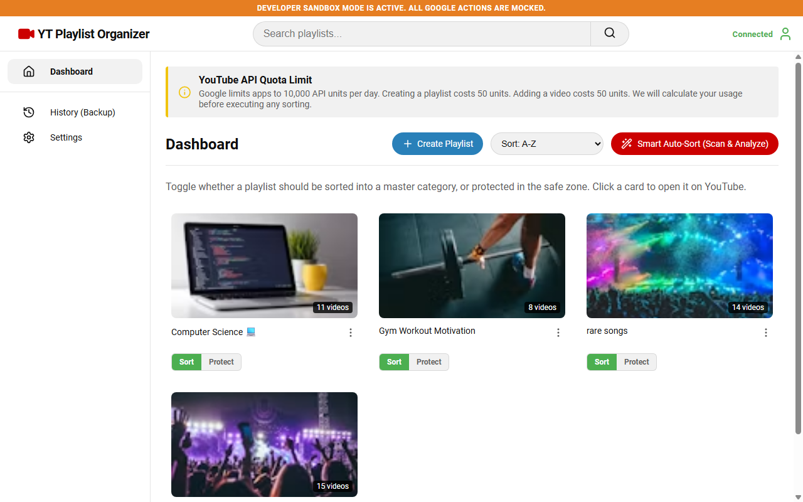
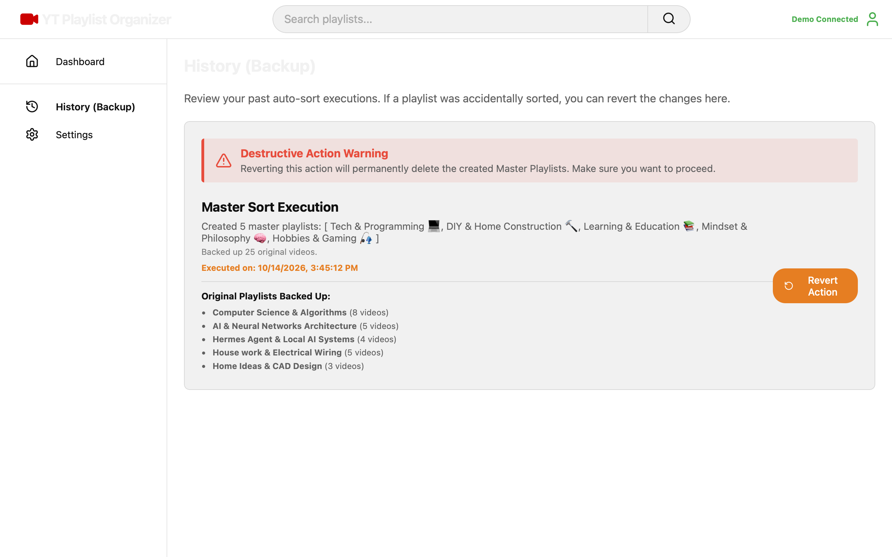
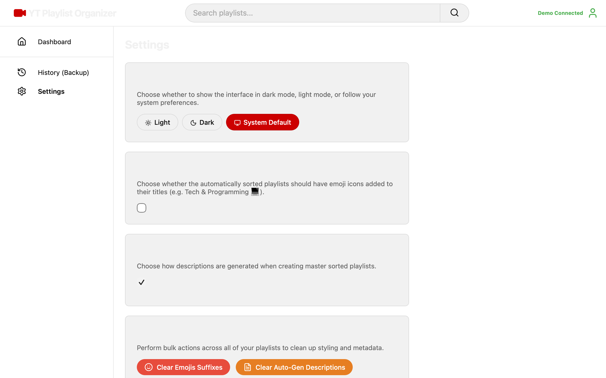

# YT Playlist Organizer

A YouTube-style, dark-mode web application designed to automatically scan, analyze, and reorganize your YouTube playlists into structured master categories using Google Identity Services (GIS) OAuth and the YouTube Data API v3.

## Screenshots

| Dashboard (Plan Preview) | Backup History (Revert Logs) |
|:---:|:---:|
|  |  |

| Appearance & General Settings |
|:---:|
|  |

## Features

- **OAuth 2.0 Integration**: Sign in securely with your Google account to manage your playlists.
- **Smart Auto-Sort**: Automatically matches, categorizes, and merges your playlists into master collections based on customizable keyword heuristics.
- **Side-by-Side Playlist Toggles**: Mark specific playlists for sorting or protect them in a safe zone (like liked songs, albums, and rare tracks) to keep them untouched.
- **Interactive Revert (Backup)**: Destructive master sorts create an automatic backup, allowing you to delete the master collections and safely restore your original video list items.
- **Appearance Modes**: Complete Dark, Light, and System Default theme integration.
- **Bulk Cleanup Tools**: Bulk clear trailing emoji suffixes or auto-generated descriptions across all your playlists in one click.
- **Playlist Management**: Create, rename, delete, and set custom cover thumbnails (either from a YouTube video URL/ID or a local image upload) via a custom in-app modal.
- **Custom Modals**: Standardized interface dialogs to prevent the browser from blocking dialog prompts.

## Setup & Installation

### 1. Clone the repository
```bash
git clone https://github.com/your-username/yt-playlist-organizer.git
cd yt-playlist-organizer
```

### 2. Configure Environment Variables
Copy the `.env.example` file to `.env`:
```bash
cp .env.example .env
```
Open `.env` and configure your Google OAuth Client ID:
```env
VITE_GOOGLE_CLIENT_ID=your_google_oauth_client_id_here
```

### 3. How to Get a Google OAuth Client ID

To run the application, you must configure a Google Cloud project to retrieve a Client ID:

1. Go to the [Google Cloud Console](https://console.cloud.google.com/).
2. Create a new project (e.g. `YouTube Playlist Organizer`).
3. In the sidebar, navigate to **APIs & Services** > **Library**, search for **YouTube Data API v3**, and click **Enable**.
4. Go to **APIs & Services** > **OAuth consent screen**:
   * Set User Type to **External** and fill in your app details.
   * Under **Scopes**, add `/auth/youtube` (manage your YouTube account) and `/auth/youtube.force-ssl`.
   * Under **Test Users**, add your own Google email address (so you can log in while in testing mode).
5. Go to **APIs & Services** > **Credentials**:
   * Click **Create Credentials** > **OAuth client ID**.
   * Choose **Web application** as the Application Type.
   * Under **Authorized JavaScript Origins**, click **Add URI** and enter `http://localhost:5173`.
   * Under **Authorized Redirect URIs**, enter `http://localhost:5173` (matching the origin).
   * Click **Create** and copy your Client ID into your local `.env` file.

### 4. Install dependencies
```bash
npm install
```

### 5. Run local server
```bash
npm run dev
```

The app will start running locally at `http://localhost:5173/`.

## Desktop App (Electron)

You can package this web application as a standalone desktop application (`.exe` for Windows, `.dmg` for macOS) so that users can download it, double-click, and run it locally on their computers.

### Run Desktop App in Development
To run the app inside a local desktop window (with hot reloading):
```bash
npm run electron:start
```

### Build Desktop Packages (.exe / .dmg)
To compile a single-file portable executable (`.exe` on Windows, `.dmg` on macOS) that requires no local installation or terminal setup:
```bash
npm run electron:build
```
The resulting files will be generated in the `/release` directory!

## Technologies Used

- **Desktop Framework**: Electron
- **Frontend**: React 19, React Router v7, Vite
- **Icons**: Lucide React
- **APIs**: YouTube Data API v3, Google Identity Services (OAuth 2.0)
- **Styling**: Vanilla CSS (CSS Variables)

## Credits
Created by **Thomas M. Brown** & **Google AntiGravity**.
